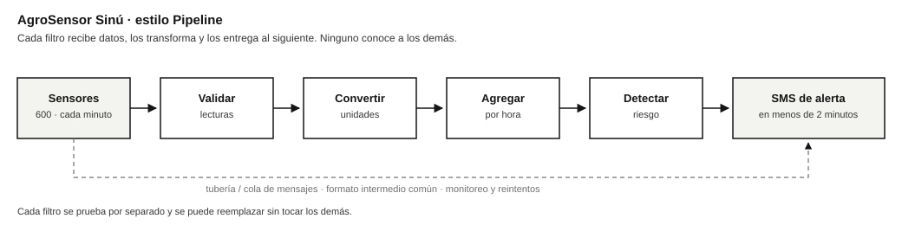

# Cuaderno del grupo · Pipeline

Diplomado en Desarrollo de Software Avanzado · Módulo 1 · Sesión 1

**Integrantes:** [Completar con los nombres y apellidos de los integrantes]

## Escenario que escogimos

**D · AgroSensor Sinú** — Monitoreo de fincas y del nivel del río en Córdoba.

| | |
| --- | --- |
| **Qué hace** | Sensores envían humedad del suelo y nivel del río cada minuto. Hay que validar las lecturas, convertir unidades, agregarlas por hora y detectar riesgo de inundación. |
| **Lo que más importa** | Si hay riesgo de inundación, el SMS de alerta llega al productor en menos de 2 minutos desde la medición. |
| **Condiciones** | 2 desarrolladores y una ingeniera agrícola. Presupuesto de un proyecto de investigación. 150 fincas, 600 sensores. |

## Qué es lo más importante que pide el escenario

Procesar cada lectura de los 600 sensores por etapas encadenadas y en tiempo casi real: recibirla, validarla, convertir unidades, agregarla por hora y detectar riesgo de inundación, de modo que el SMS de alerta llegue al productor en menos de 2 minutos. Lo esencial es transformar un flujo continuo de datos paso a paso, sin que una etapa dependa de la lógica interna de las demás.

## Por qué nuestro estilo responde a eso

Porque el problema es, literalmente, una cadena de transformaciones sobre datos: sensores → validación → conversión de unidades → agregación horaria → detección de riesgo → alerta SMS. El estilo Pipeline permite implementar cada etapa como un filtro independiente y simple, que se prueba por separado y se puede reordenar, reemplazar o reutilizar (por ejemplo, cambiar la conversión si se agrega otro tipo de sensor) sin tocar las demás etapas. Además, el flujo no depende de decisiones del usuario a mitad de camino: los datos entran y salen solos, justo el caso de uso recomendado para ETL y procesamiento de sensores. Así se puede cumplir el límite de 2 minutos y mantener el sistema comprensible para 2 desarrolladores y una ingeniera agrícola.

## Qué se sacrifica

Cada paso agrega latencia y hay que definir y mantener un formato intermedio entre filtros; si un filtro se cae, se atrasa o recibe lecturas desordenadas o duplicadas, la alerta puede llegar tarde. Por eso hay que sumar monitoreo, reintentos y control de flujo, algo que encarece la operación para un equipo de 2 personas y un presupuesto de investigación. Tampoco es la mejor opción si más adelante el flujo necesita interacción compleja con el usuario o reglas distintas por finca; en ese caso habría que combinar el pipeline con otro estilo.

## Dibujo (opcional)

Archivo: `diagrama_pipeline_agrosensor.svg`

## Nuestro estilo: Pipeline

> Como una línea de ensamblaje, o como `cat ventas.csv | grep 2026 | sort` en la terminal.

- **Componentes:** filtros que reciben datos, los transforman y los entregan.
- **Conectores:** tuberías (stream, cola o archivo) entre filtros.
- **Regla:** cada filtro es independiente y no conoce a los demás.
- **Despliegue:** variable: desde un proceso hasta varios servicios.

**Gana**

- Cada filtro es simple y se prueba solo.
- Los filtros se reordenan, se reemplazan o se reutilizan.

**Pierde**

- No sirve para interacción compleja con usuarios.
- Con muchos pasos pesan la latencia acumulada y el formato intermedio.

**Úsalo cuando**

- Hay que procesar datos por etapas: ETL, sensores, imágenes.
- Compiladores, CI/CD.

**Evítalo cuando**

- El flujo depende de muchas decisiones del usuario a mitad de camino.

**Ejemplos:** pipes de Unix, procesos ETL, compiladores (léxico, sintáctico, semántico, código), pipelines de CI/CD.

**Cuidado con:** filtros que dependen del estado interno de otros filtros.
